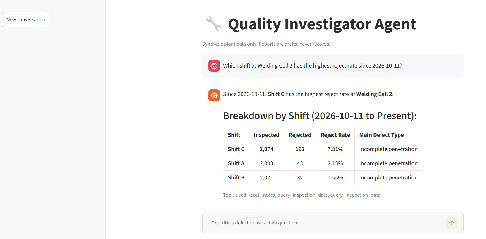
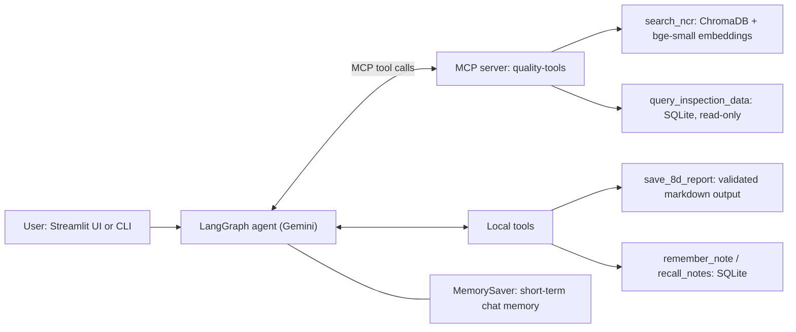
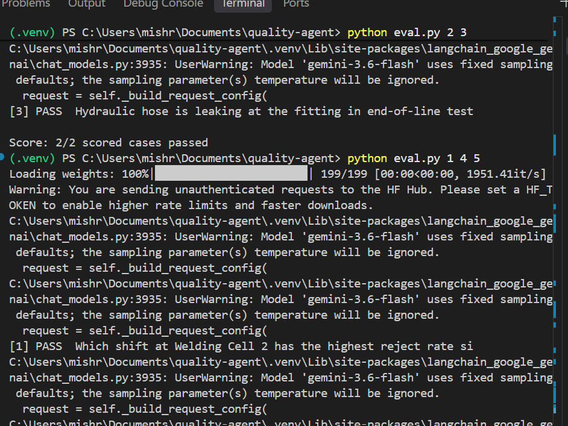

# Quality Investigator Agent

An agentic AI assistant that helps a quality engineer investigate manufacturing
defects. It searches past non-conformance reports (NCRs), analyses inspection
data with SQL, and drafts 8D reports, using only evidence from its tools.

> Personal learning project. All data is **synthetic**. No employer or
> production data is used. Reports are drafts, never quality records.



## What it does

- Finds similar past NCRs by meaning (RAG), not just keywords
- Answers data questions ("which shift has the highest reject rate?") by
  writing read-only SQL
- Drills down station, then shift, then date, and chains tools for an investigation
- Drafts an 8D report (D1 to D8) with unverified items marked as hypotheses
- Remembers context in a conversation and saves notes across sessions

## Architecture



| Part | Choice |
|---|---|
| LLM | Gemini (free tier) |
| Agent framework | LangGraph (reason, act, observe loop) |
| Embeddings | BAAI/bge-small-en-v1.5 (local) |
| Vector DB | ChromaDB, one chunk per NCR |
| Tool protocol | MCP (NCR search and SQL run as a separate server) |
| Memory | LangGraph checkpointer (short-term), SQLite notes (long-term) |
| UI | Streamlit |

## Safety design

- SQL tool opens the database **read-only** and accepts only `SELECT`
- Report tool **rejects** incomplete or empty reports, so the agent must retry
- System prompt forbids inventing NCR IDs, dates, names, or completed actions
- Evaluation checks that any NCR ID the agent cites exists in the data

## Run it

```
git clone https://github.com/prashant20296/quality-agent.git
cd quality-agent
py -3.12 -m venv .venv
.venv\Scripts\activate
pip install -r requirements.txt
copy .env.example .env      # then add your Google AI Studio key
python make_inspection_db.py
python ingest.py
streamlit run ui.py
```
Needs Python 3.12 and a free Gemini API key from https://aistudio.google.com/apikey.

## Evaluation

`python eval.py` runs 5 test cases: a data question with a known answer, a
definition that should use no tools, a defect that should find a specific NCR,
a defect with no match (must not invent), and a count checked against the
database. [Add your real results here, for example "5/5 passed on date, model".]



## Limitations

- Synthetic data, so findings do not reflect a real plant
- Free-tier LLM limits (requests per day) restrict how much it can be tested
- Checks are keyword-based, so a failure needs human review
- Root causes are hypotheses; the agent cannot verify anything on the shop floor

## Possible next steps

Hybrid search with a reranker, human approval before saving reports, an
LLM-judge evaluation, deployment on a cloud service.